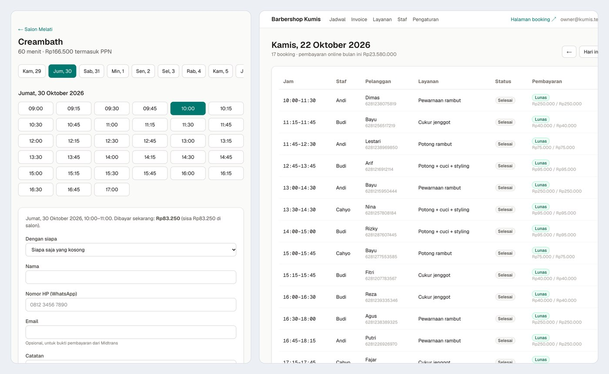

# Salon Booking & Invoice SaaS

[](https://github.com/dinulimann/salon-booking-saas/actions/workflows/ci.yml)



Online booking and invoicing for small Indonesian salons and barbershops. Each salon signs up, gets its own booking page (`/s/<salon>`), and customers pick a service, a time and a stylist, then pay a deposit or the full price through **Midtrans Snap** (QRIS, e-wallets, bank transfer, cards). The owner sees the day's schedule, invoices, services, staff and settings.

Built with **Next.js 16** (App Router, server actions), **TypeScript**, **PostgreSQL 16** with **Drizzle ORM**, **Better Auth**, **Zod** and **Tailwind CSS**, tested with **Vitest** and **Playwright**.

The interesting part is not the forms but the things a booking system usually gets wrong:

- **One salon can never see another salon's data.** Every tenant table has PostgreSQL **row-level security**. The app connects as a role that is subject to RLS and sets the salon per transaction, so even a query with no `WHERE` clause only returns the current salon's rows, and writing a row for another salon fails in the database.
- **No double booking, even under a race.** An exclusion constraint on `(staff_id, time range)` covers held and confirmed bookings. In the tests, 20 customers try the same barber at the same minute at once: exactly one wins, the rest are told the slot is gone.
- **Unpaid bookings don't block the calendar.** A booking holds its slot for 15 minutes (configurable per salon) while the customer pays; after that the slot is free again.
- **Payment notifications can't be faked or replayed.** The Midtrans signature is checked, then the status is re-read from Midtrans' own Status API and that answer is applied. Status only moves forward, so repeated or late notifications change nothing, and a wrong amount is logged and ignored.
- **The awkward cases are handled.** Payment after the hold expired: the booking is reinstated if the slot is still free, otherwise flagged for refund on the dashboard. A payment that expires cancels the booking, voids the invoice and frees the slot.
- **Invoice numbers have no gaps,** per salon per year, even when 15 payments arrive at the same moment. An invoice keeps the name it was issued to, even if a returning customer (same phone number) later uses a different name.
- **Money and time are exact.** Whole rupiah only, 11% PPN rounded half up, deposits as a percentage of the total including tax. Opening hours are kept in the salon's own time zone (WIB, WITA…), with split shifts and a minimum lead time; slots are offered every 15 minutes wherever the whole service fits.
- **The payment audit trail is append-only.** The app role can insert payment events but cannot change or delete them.

## Tests

| Suite | What it covers | Tests |
|---|---|---|
| Unit (Vitest) | slot finding, time zones, money and tax, invoice numbers, phone numbers, Midtrans signatures and status rules | 17 |
| Database (Vitest + PostgreSQL) | row-level security, double booking under concurrency, hold expiry, payment handling, gapless invoice numbers | 16 |
| End-to-end (Playwright) | book and pay, let a payment expire, owner sees the invoice while another salon's owner can't, dashboard needs a login, forged notification rejected | 5 |

CI runs typecheck, lint, the 33 unit and database tests, a production build and the 5 end-to-end tests on every push. In CI and the end-to-end tests, payments go to `tools/fake-midtrans.mjs`, a local server that speaks the same Snap and Status API and signs notifications the same way.

**Limits:** the app has not been run against the real Midtrans sandbox yet (that needs a merchant account and keys). Booking reminders by WhatsApp or email are not built.

## Run it

Requirements: Node.js 22, Docker.

```bash
cp .env.example .env              # set BETTER_AUTH_SECRET; Midtrans sandbox keys if you have them
npm ci
docker compose up -d --wait       # PostgreSQL on localhost:5564
npx tsx scripts/migrate.mts       # schema, RLS policies and roles
npx tsx scripts/seed.mts          # two demo salons with staff, services and past bookings
npm run dev                       # http://localhost:3000
```

Demo salons: `/s/kumis` (Barbershop Kumis, full payment) and `/s/melati` (Salon Melati, 50% deposit, 11% PPN). Owner logins: `owner@kumis.test` and `owner@melati.test`, password `demo12345`.

Without real Midtrans keys, use the local stand-in: run `node tools/fake-midtrans.mjs` and set `MIDTRANS_SNAP_URL=http://localhost:4010/snap/v1` and `MIDTRANS_API_URL=http://localhost:4010/v2`.

Tests:

```bash
npx vitest run                          # unit + database tests (needs the database above)
npx next build && npx playwright test   # end-to-end with the fake Midtrans; see .github/workflows/ci.yml for the env
```

## Structure

```
src/app/s/[slug]/        customer pages: services, booking, payment status
src/app/dashboard/       owner pages: schedule, invoices, services, staff, settings
src/app/api/midtrans/    payment notification endpoint
src/lib/                 availability, booking, payments, money, time, Midtrans client
src/db/                  Drizzle schema and the per-salon transaction helper
drizzle/                 SQL migrations, including RLS policies and the exclusion constraint
tests/unit, tests/db     Vitest suites
e2e/                     Playwright tests
tools/fake-midtrans.mjs  local Midtrans stand-in for CI and offline demos
```
